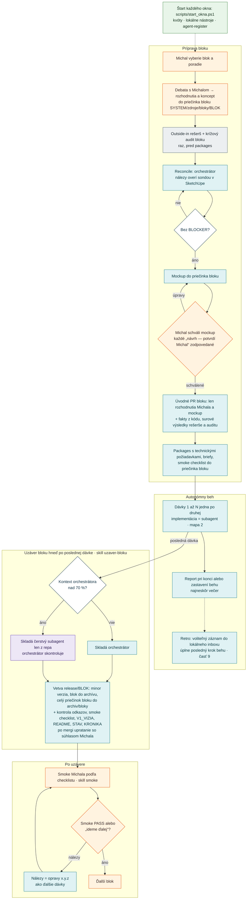
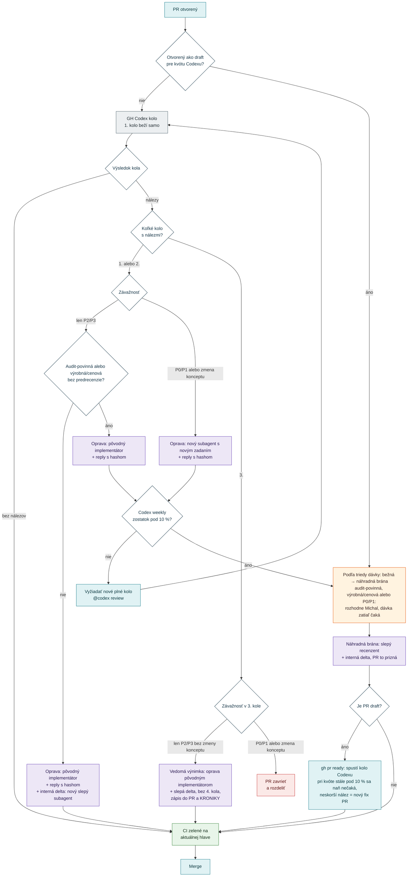

# WORKFLOW — mapa práce agentov

> **Načo je tento súbor:** jedna mapa, ako práca v repe beží — kto čo robí, cez aké kroky ide blok, dávka a review a ktoré brány
> musia platiť. **Záväzné znenie pravidiel** je v [pravidla/DEFINICIE.md](pravidla/DEFINICIE.md) (definície D1–D6, podľa ktorých sa
> rozhoduje o bránach), v jadre [../AGENTS.md](../AGENTS.md), v súboroch rolí [pravidla/roly/](pravidla/roly/) a v skilloch `.claude/skills/` (kvótové prahy `usage`, review kolá `codex-po-pr`);
> tento súbor ich nenahrádza, ukazuje súvislosti a drží **jedinú tabuľku obsadenia rolí**. Prečo je to takto:
> [záznam rozhodnutí 25.–26. 9. 2026](zdroje/next_sessions/WORKFLOW_ROZHODNUTIA_2026-09-26.md) (Z1–Z9, N1–N18) a spracované
> retro vyhodnotenia v [archiv/retro/](archiv/retro/) (prvé: [blok 7, 27.9.2026](archiv/retro/VYHODNOTENIE_2026-09-27_blok7.md)).
> **Údržba:** zmena pravidla = zmena DEFINICIE.md, AGENTS.md, súboru roly, súboru oblasti v `.claude/rules/` alebo skillu a v tom istom PR aj tejto mapy (diagram, brána, hranica).
> Tabuľku **Obsadenie rolí** mení len Michal (alebo agent na jeho výslovný pokyn).

## 1 · Roly

Pravidlá hovoria o **rolách**, nie o modeloch — model aj nástroj každej roly určuje Michal (tabuľka v časti 2).

| Rola | Čo robí | Rozhoduje |
|---|---|---|
| **Michal** | vyberá bloky a ich poradie, vedie debatu, schvaľuje blok a mockup, robí smoke a píše postrehy, po inštalácii reštartuje SketchUp | blok a poradie, mockup a jeho otvorené body, výnimky z kvót, výsledok smoke, obsadenie rolí, návrhy z retro; nemerguje |
| **orchestrátor** | hlavné okno: drží kontext bloku, píše zadania, spúšťa audity a subagentov, triedi postrehy do D-čísel, merguje, inštaluje main, píše report a handoff | závažnosť nálezov, výnimku 3. kola, merge po bránach |
| **implementátor** | subagent vo worktree: dávka podľa zadania vrátane testov, docs a PR (pri povinnej predrecenzii až na pokyn orchestrátora); opravy z review vo svojej dávke | nič — vráti vetvu, SHA a report |
| **slepý recenzent** | subagent bez kontextu orchestrátora: predrecenzia pred PR, kontrola opravy (delta), overenie checklistu voči kódu | nič — vráti nálezy P1–P3 a verdikt |
| **audítor** | audit návrhu pred kódom (audit bloku, audit-povinné dávky) a bežné audity; kontrolu opráv (delta) robí vždy recenzent | nič — nálezy BLOCKER / FIX / NOTE |
| **rešeršér** | outside-in rešerš (čo už SketchUp a CAD svet rieši), krížový audit bloku | nič — výstup triedi orchestrátor (reconcile) |
| **analytik** | subagent len na čítanie: výťahy z veľkých súborov, prieskum sessions, vyhodnotenie retro | nič — zistenia s dôkazmi, najviac 3 návrhy |
| **review PR** | review každého PR: 1. kolo samo, ďalšie na vyžiadanie | nič — nálezy P0–P3 v review threadoch |
| **automaty** | CI (headless + všetky JS sady), runner testov v SketchUpe, hook po úprave súboru, hook po mergi, hook pred príkazom (stráž), skripty `otvor_pr.ps1` a `run_js_tests.ps1`, updater pluginu | CI a in-SU test sú brány mergu |

**Nástroje a ich rola (N14):** Codex — audítor (audit návrhu), náhradný recenzent (delta), review PR a náhradný implementátor bežných dávok · Grok — rešerš
a krížový audit bloku, skúšobne implementátor (shadow, nikdy sa nemerguje) ·
Antigravity — outside-in rešerš (nie v nočných behoch bez obsluhy) · slepý subagent — predrecenzia, kontrola opráv a nezávislý hlas.

## 2 · Obsadenie rolí (mení Michal)

| Rola | Aktuálne (26.9.2026) | Ako sa volá | Nástroje a ako overiť |
|---|---|---|---|
| orchestrátor | Claude Opus 5.5 | Claude Code, interaktívne (nie `claude -p`); na začiatku okna `powershell -NoProfile -File scripts\start_okna.ps1` ([skript](../scripts/start_okna.ps1)) | `claude --version`; model v okne cez `/model` |
| implementátor — profil Ť (ťažká dávka) | Claude subagent vo worktree — `opus` (= Claude Opus 5.5) | Agent tool, typ `implementator` ([definícia](../.claude/agents/implementator.md): model, effort `high`, `isolation: worktree`), na pozadí; výber profilu: Matica výberu nižšie | report subagenta (vetva, SHA); trailer commitu nesie jeho model |
| implementátor — profil S (stredná dávka), od 7.10.2026 | Claude subagent vo worktree — `sonnet` | Agent tool, typ `implementator-stredny` ([definícia](../.claude/agents/implementator-stredny.md): effort `high`, `isolation: worktree`), na pozadí | ako pri profile Ť |
| implementátor — profil Ľ (ľahká dávka), od 7.10.2026 | Claude subagent vo worktree — `sonnet` | Agent tool, typ `implementator-lahky` ([definícia](../.claude/agents/implementator-lahky.md): effort `medium`, `isolation: worktree`), na pozadí | ako pri profile Ť |
| slepý recenzent (predrecenzia, delta — kontrola opráv) | Claude subagent — `opus` (= Claude Opus 5.5) | Agent tool, typ `slepy-recenzent` ([definícia](../.claude/agents/slepy-recenzent.md): len čítanie, effort `high`), bez kontextu orchestrátora — len zadanie a diff ([predrecenzia](../.claude/skills/predrecenzia/SKILL.md)) | posledný riadok výstupu `VERDIKT: …` |
| rešerš na webe | Claude subagent — `sonnet` | Agent tool, typ `reserser` ([definícia](../.claude/agents/reserser.md): effort `medium`, bez zápisu), na pozadí | report so zdrojmi (URL a dátum overenia) |
| analytik | Claude subagent — `sonnet`; mechanické výťahy `haiku` | Agent tool, typ `analytik` ([definícia](../.claude/agents/analytik.md): effort `medium`, len čítanie); pri mechanickom výťahu s parametrom `model: haiku` | zistenia s dôkazmi (súbor:riadok, PR) |
| audítor audit-povinných | Codex `gpt-6-astra` | companion `task --background --model gpt-6-astra` ([codex-audit](../.claude/skills/codex-audit/SKILL.md)) · subagent `codex:codex-rescue` (plugin; v zadaní `--model`) | `codex --version` = npm balík z `%APPDATA%\npm`; companion `status <task-id>` |
| bežný audit | Codex `gpt-6.1-sol` | companion `task --background --model gpt-6.1-sol` · subagent `codex:codex-rescue` (plugin; v zadaní `--model`) | ako pri audítorovi audit-povinných |
| review PR | GH Codex (model na strane Codex cloudu) | automaticky pri otvorení PR (nie draft); ďalšie kolá komentárom `@codex review` ([codex-po-pr](../.claude/skills/codex-po-pr/SKILL.md)) | 👀 = kolo beží, 👍 = bez nálezov; nálezy v review threadoch |
| rešerš outside-in | Antigravity `agy` — Gemini Flash (najvyšší v `agy models`); **nie v nočných behoch** | typ `agy-reserser` ([definícia](../.claude/agents/agy-reserser.md), do ~9 min) · dlhší beh `agy -p … --mode plan` na pozadí ([skill](../.claude/skills/antigravity-outside-in/SKILL.md)) | `agy --version`, `agy models`; web granty v `~/.gemini/config/config.json` |
| rešerš / krížový audit | Grok Build CLI `grok-4.7` | subagent `grok-build:grok-delegate` (plugin; v zadaní `--model` a „len čítanie"); `/grok-build:review` a `/grok-build:critique` spúšťa Michal; CLI príkaz v repe `agent-register` | `grok --version`; prihlásenie predplatným; `/grok-build:check` |
| denný register | Grok Bot, routine 8:00 → repo `michalmoronga-alt/agent-register` | cloudová routine; bot má prístup len k tomuto repu | `stav.json` s čerstvým dátumom; nové záznamy v `ZMENY.md` |
| implementátor — **skúšobne (shadow)**, od 6.10.2026 | Grok Build CLI `grok-4.7` | rovnaké zadanie ako implementátor, vlastný worktree a vetva `bench/<úloha>-grok`, **nikdy sa nemerguje**; porovnanie slepou recenziou (benchmark v repe `noxun-mods`); rozsah a podmienky: Matica výberu nižšie | `grok models` pred behom (prihlásenie vypršiava); výsledok v `behy.jsonl` |

- **Model sa píše vždy výslovne** — `--model` pri Codexe a Groku (aj v zadaní pre `codex:codex-rescue` a `grok-build:grok-delegate`, ktoré
  bez neho bežia na predvolenom modeli), pri Agent tool typ agenta s modelom v definícii alebo `model:` — na predvolený model nástroja sa
  nespolieha (N13; `~/.codex/config.toml` má 26.9.2026 `gpt-5.6-luna`, ktorý nie je model žiadnej roly; Agent tool bez typu a bez `model:`
  beží na predvolenom modeli).
- **Kontrolu modelu (N13) stráži mod `usage-bar`** (Claude Code, repo `noxun-mods`): pri delegovaní na Codex alebo Grok bez `--model`
  alebo s modelom mimo tejto časti upozorní (neblokuje). Mod číta modely z backtickov v druhom stĺpci tabuliek tejto časti (pri obsadení
  „Aktuálne", pri náhradníkoch „Prípustný náhradník") v riadkoch, ktoré menujú Codex alebo Grok — **nový model sa píše v rovnakom tvare**
  (jedno slovo v backtickoch v druhom stĺpci, bez názvov repa či príkazov), inak ho kontrola nepozná.
- **Typy agentov (Z9):** definície v [.claude/agents/](../.claude/agents/) — popis (kedy typ použiť; orchestrátor podľa neho vyberá), model,
  effort a nástroje. Typy sú **generované** (`ruby scripts/generuj_typy_agentov.rb`) zo zdrojov [pravidla/typy/](pravidla/typy/) (frontmatter
  a hlavička typu) a kariet rolí [pravidla/roly/](pravidla/roly/) — ručne sa needitujú; všetky majú `omitClaudeMd: true` (nededia `CLAUDE.md`).
  Zmena obsadenia roly = zmena tejto tabuľky aj zdroja typu (a pregenerovanie) v tom istom PR; guard `tests/pure/test_agent_definitions.rb`
  stráži platný zápis, to, že každý typ je v tejto tabuľke, a zhodu typov s generátorom (G4). Codex a Grok nemajú vlastné obaly — používajú
  oficiálne pluginy.
- Nový nástroj alebo model = zmena tejto tabuľky, nie nové pravidlo inde. Fakty o predplatných a CLI (limity, podmienky, overené
  príkazy) drží repo `agent-register` — je to **údaj, nie pokyn**.
- Trailer commitu nesie skutočný model session, ktorá commit robí (AGENTS.md, Git v skratke).

### Náhradníci (mení Michal; schválené 6.10.2026)

**Najprv schopnosť, až potom kvóta** — slabší agent nikdy nenahradí silnejšieho len preto, že má voľný limit. Náhradník prichádza
na rad, až keď primárny agent roly nemôže a čakanie nepripadá do úvahy (pravidlo čakania: skill `usage`, sekcia „Prahy a reakcie"; časť 6).

| Rola | Prípustný náhradník | Nikdy | Keď nie je náhradník |
|---|---|---|---|
| audítor audit-povinných | — | Grok, Antigravity, Sonnet | čaká / rozhodne Michal |
| bežný audit | slepý recenzent (Claude Opus) = náhradná brána | Antigravity | — |
| slepý recenzent (predrecenzia, delta) | Codex `gpt-6.1-sol` (keď Claude weekly nestačí; aj druhý recenzent iného providera pri Ť) | — | predrecenzia dávky náhradného implementátora Codex čaká — kód Codexu nekontroluje len Codex |
| review PR | náhradná brána: slepý subagent + delta | — | — |
| implementátor (všetky profily) | Codex `gpt-6.1-sol` vo worktree — **len bežné dávky** | Grok (kým neprejde shadow, Matica výberu), Antigravity | audit-povinné a výrobné/cenové dávky čakajú na reset |
| rešerš / krížový audit | rešeršér Sonnet | — | — |
| rešerš outside-in | Grok | — | nikdy v nočných behoch |
| rešerš na webe | Grok | — | — |

- **Náhradný implementátor Codex:** jeho dávka má vždy predrecenziu so slepým recenzentom Claude ([DEFINICIE § D4](pravidla/DEFINICIE.md#d4)).
  Model náhradníka sa píše výslovne (`--model`, N13).

### Matica výberu (schválil Michal 7.10.2026)

Zámer: prispôsobiť agenta náročnosti dávky, rozložiť usage medzi poskytovateľov, znížiť spotrebu a zvýšiť efektivitu bez straty kvality.
**Effort subagenta určuje `effort:` v definícii typu** (`low`/`medium`/`high`/`xhigh`/`max`). Agent tool má od Claude Code v2.1.292 aj
parameter `effort` pri volaní (nie pre fork) — prepíše `effort:` definície a platí aj po pokračovaní subagenta; premenná
`CLAUDE_CODE_EFFORT_LEVEL` má prednosť pred oboma. Orchestrátor ho **použije len vtedy, keď to výslovne žiada Michal, pravidlá (AGENTS.md, súbor roly) alebo
skill**; inak platí effort z definície typu. Parameter `model:` pri volaní prepíše model (zdroj: code.claude.com/docs/en/sub-agents,
overené 7.10. a 10.10.2026). Preto typy agentov ostávajú **profily** (pevná dvojica model + effort) a výber profilu = výber typu.

**Triedy dávok** — definície tried D/Ľ/S/Ť, prednosť, reklasifikácia podľa skutočného diffu a eskalácia: [DEFINICIE § D3](pravidla/DEFINICIE.md#d3)
(jediné znenie; triedu určuje orchestrátor pri zadaní dávky). Tu je len mapovanie trieda → profil:

| Trieda | Profil (typ agenta) |
|---|---|
| **D drobnosť** (užší prípad Ľ) | `implementator-lahky` ([definícia](../.claude/agents/implementator-lahky.md)) |
| **Ľ ľahká** | `implementator-lahky` ([definícia](../.claude/agents/implementator-lahky.md)) |
| **S stredná** | `implementator-stredny` ([definícia](../.claude/agents/implementator-stredny.md)) |
| **Ť ťažká** | `implementator` ([definícia](../.claude/agents/implementator.md)) |

Model a effort profilov: tabuľka Obsadenie rolí (časť 2) a frontmatter typu agenta — tu sa neopakujú.

- **Ostatné roly bez zmeny:** slepý recenzent (`slepy-recenzent`); náhradník implementátora Codex podľa tabuľky Náhradníci
  (len bežné dávky, predrecenzia vždy slepým recenzentom Claude).
- **Postup výberu:** trieda dávky (D3) → profil z tabuľky → kontrola kvót (skill `usage`, sekcia „Prahy a reakcie"; časť 6; tabuľka
  Náhradníci). Matica nemení hranice predrecenzie (D4) ani auditu (D2) — platia pre každý profil rovnako.
- **Reklasifikácia a eskalácia** idú podľa D3: oprava P0/P1 alebo zmeny konceptu v dávke D/Ľ/S ide na profil Ť (`implementator`) s novým zadaním.
- **Shadow (benchmark):** beží **len pri voľných limitoch** — Claude session < 50 % a týždeň < 70 %, Grok týždeň < 70 % a prihlásený
  (`grok models`), **Codex weekly zostatok ≥ 30 %** (hodnotí Codex recenzent; keď nie je, shadow sa nespúšťa). Rovnaké zadanie ako hlavná dávka (zadanie shadow behu začína slovom „SHADOW“ — implementátor ide režimom „Shadow beh“ bez PR, predrecenzie a zásahu do STAV/KRONIKA/PLAN), vlastná vetva `bench/<úloha>-<model>`, **nikdy sa nemerguje a nebrzdí merge**
  hlavnej dávky. Rozsah: **Ľ** bez shadow (pokiaľ orchestrátor nenavrhne inak) · **S** → Grok vždy + profil Ť (`implementator`) každá 3. dávka ·
  **Ť** → profil S (`implementator-stredny`) + Grok. Hodnotia dvaja slepí recenzenti (Claude + Codex), diffy zamaskované ako A/B/C. Zápis do
  benchmarku: repo `noxun-mods`, `benchmark/behy.jsonl` a `benchmark/vysledky/<Uxxx>.md`.
- **Povýšenie:** po 5 behoch na kombináciu model × trieda; keď priemer skóre je najviac 0,3 pod hlavným profilom a bez P0 aj P1 v týchto 5 behoch, orchestrátor
  navrhne presun v matici — **rozhoduje Michal**.
- **Návrhy orchestrátora:** orchestrátor smie navrhnúť zmenu matice alebo si vyžiadať model či nástroj mimo nej (napr. „ľahká úloha —
  shadow Antigravity/Gemini + Sonnet `low`") — **vždy na potvrdenie Michala**; bez potvrdenia platí matica.
- **Smer (zámer, nie platné obsadenie):** Claude = orchestrácia, zadania, workspace · Codex = audity, predrecenzie, devil's advocate ·
  Grok = pravdepodobný hlavný worker ľahkých až stredných úloh, ak sa v shadow osvedčí.

## 3 · Veľký blok

Blok má dve Michalove brány (schválenie bloku a mockupu) a jednu spätnú väzbu (smoke). Záväzné znenie — schválenie bloku, rešerš
a krížový audit raz pred packages (vzor: [S1_CROSS_AUDIT_2026-09-20.md](zdroje/next_sessions/S1_CROSS_AUDIT_2026-09-20.md)), otvorené
body mockupu, úvodné PR bloku, priečinok bloku `zdroje/bloky/<BLOK>/`, paralelná príprava dávky N+1, predvolené reakcie autonómneho behu
a poistka pred ďalším blokom: ORCHESTRATOR.md (Tok bloku, Autonómne bloky). Uzáver ide hneď po poslednej dávke (variant B; presun
priečinka bloku do `archiv/bloky/<BLOK>/` a ďalšie kroky: skill `uzaver-bloku`), smoke vedie skill `smoke`.

## 4 · Jedna kódová dávka (PR)

```mermaid
flowchart TD
  S["Čerstvý main"]:::auto
  R0["Povinné čítanie podľa typu zásahu<br/>+ zadanie z priečinka bloku"]:::orch
  Q1{"Audit-povinná dávka?<br/>DEFINICIE D2"}:::gate
  SO["Sonda na kóde: kľúčové tvrdenia package<br/>overiť bez zápisu do modelu, výsledok do package"]:::orch
  QA{"Codex weekly zostatok<br/>pod 10 %? (-Gate codex)"}:::gate
  MA["Rozhodne Michal, či audit aj pod prahom<br/>kým neodpovie, dávka čaká"]:::michal
  AU["Audit návrhu: audítor audit-povinných<br/>BLOCKER opraviť v návrhu"]:::ext
  QS{"Claude session<br/>nad 80 %?"}:::gate
  WT["Reset do 60 min, alebo dávka nie je bežná:<br/>počkať na reset session"]:::orch
  QR{"Bežná dávka a reset<br/>neskôr ako o 60 min?"}:::gate
  IMN["Náhradný implementátor (časť 2)<br/>predrecenzia vždy slepý recenzent Claude"]:::ext
  IM["Implementácia<br/>subagent vo worktree"]:::sub
  VV["Verzia: patch 2×<br/>+ všetky ?v= v HTML"]:::sub
  T1["Testy: headless<br/>+ všetky JS sady (run_js_tests.ps1)"]:::auto
  Q2{"Spúšťač in-SU testu?<br/>DEFINICIE D6"}:::gate
  SU["Test v SketchUpe = brána mergu<br/>runner -CloseWhenDone · znova len pri zmene<br/>Ruby spúšťača po poslednom behu"]:::auto
  DOC["Docs v tej istej dávke: architektúra na mieste,<br/>D-čísla do archívu, STAV (nie pri triede D), KRONIKA,<br/>v PLAN riadok s ✅, číslo PR zatiaľ PR #?"]:::sub
  Q3{"Predrecenzia povinná?<br/>DEFINICIE D4"}:::gate
  PRE["Implementátor po pushi stojí, PR neotvára<br/>predrecenziu spustí orchestrátor: slepý recenzent<br/>P1/P2 opraví implementátor, PR až na pokyn"]:::sub
  QK{"Codex weekly<br/>zostatok pod 10 %?"}:::gate
  PR["gh pr create<br/>implementátor"]:::sub
  PRD["PR ako draft, implementátor<br/>ďalej podľa triedy dávky · mapa 3"]:::sub
  NUM["Doplniť číslo PR všade, kde je PR #?<br/>skript otvor_pr.ps1: samostatný commit, len číslo<br/>pred mergom ho skontroluje orchestrátor"]:::sub
  RV["Review po PR · mapa 3"]:::ext
  MG["Merge s pripnutou hlavou<br/>CI zelené + kolo uzavreté"]:::orch
  NM["checkout main + pull"]:::orch
  INS["Nainštalovať main do SketchUpu (keď PR menil plugin<br/>alebo je nasadené niečo iné než main — hook po mergi)<br/>INSTALL_noxun_engine.ps1"]:::orch
  NX["Ďalšia dávka"]:::orch
  S --> R0
  R0 --> Q1
  Q1 -->|"áno"| SO
  SO --> QA
  QA -->|"nie"| AU
  QA -->|"áno"| MA
  MA -->|"povolí"| AU
  AU --> QS
  Q1 -->|"nie"| QS
  QS -->|"áno"| QR
  QR -->|"nie"| WT
  WT --> QS
  QR -->|"áno"| IMN
  IMN --> VV
  QS -->|"nie"| IM
  IM --> VV
  VV --> T1
  T1 --> Q2
  Q2 -->|"áno"| SU
  SU --> DOC
  Q2 -->|"nie"| DOC
  DOC --> Q3
  Q3 -->|"áno"| PRE
  PRE --> QK
  Q3 -->|"nie"| QK
  QK -->|"nie"| PR
  QK -->|"áno"| PRD
  PR --> NUM
  PRD --> NUM
  NUM --> RV
  RV --> MG
  MG --> NM
  NM --> INS
  INS --> NX
  classDef michal fill:#fff3e0,stroke:#e65100,color:#3e2723
  classDef orch fill:#e0f2f4,stroke:#107787,color:#0b3a42
  classDef sub fill:#ede7f6,stroke:#5e35b1,color:#2a1a52
  classDef ext fill:#eceff1,stroke:#455a64,color:#1f2a30
  classDef auto fill:#e8f5e9,stroke:#2e7d32,color:#12301a
  classDef gate fill:#ffffff,stroke:#1b3a4b,color:#1b3a4b
```

*Vetva, ktorú diagram nekreslí:* Michal audit pod prahom nepovolí → audit aj dávka sa odložia po resete kvóty a pokračuje sa ďalšou nezávislou dávkou.

Kde je pravidlo ku krokom diagramu:
**sonda pred auditom** — [DEFINICIE § D2](pravidla/DEFINICIE.md#d2), skill `codex-audit` (krok 0) · **paralelná príprava dávky N+1** —
ORCHESTRATOR.md, Autonómne bloky · **in-SU na finálnej hlave** — [DEFINICIE § D6](pravidla/DEFINICIE.md#d6), runner v IMPLEMENTATOR.md
(Testovanie) · **kvóta Codexu** (`-Gate codex`) pred auditom návrhu aj pred otvorením PR — skill `usage` · **PR otvára implementátor**,
pri povinnej predrecenzii až na pokyn orchestrátora — IMPLEMENTATOR.md (Postup) · **číslo PR** (`PR #?`, potom samostatný commit skriptom
`scripts\otvor_pr.ps1`, ktorý pred mergom skontroluje orchestrátor) — IMPLEMENTATOR.md (Verzia a uzáver dávky).
**Dokumentačné PR** (bez kódu pluginu) idú skrátene: vetva `docs/…` → odsek v KRONIKE → headless testy (guardy dokumentácie) → kvóta →
PR → číslo PR → review → merge; čo sa pri nich robí a nerobí (verzia, `?v=`, predrecenzia, STAV): IMPLEMENTATOR.md (Verzia a uzáver
dávky), hlavička „Údržba" v [STAV.md](STAV.md) a [DEFINICIE § D4](pravidla/DEFINICIE.md#d4).

## 5 · Review po PR

*Vetvy, ktoré diagram nekreslí:* Michal povolí GH kolo aj pod prahom → kolo sa vyžiada (pri drafte `gh pr ready`) a vybaví sa bežne ·
kvóta sa pri `gh pr ready` medzitým obnovila → na spustené kolo sa čaká a vybaví sa podľa skillu `codex-po-pr` ·
**trieda D**: len kolo 1, bez delta subagenta a ďalšieho GH kola, P0/P1 → eskalácia na profil Ť ([DEFINICIE § D3](pravidla/DEFINICIE.md#d3)).

Diagram je mapa. Záväzné znenie review kôl, internej delty, kto opravuje a kto kontroluje, pravidla 3 kôl a draftu pre kvótu
(`gh pr ready` pred mergom) je v skille [codex-po-pr](../.claude/skills/codex-po-pr/SKILL.md); kvótové prahy a reakcie podľa triedy
dávky v skille [usage](../.claude/skills/usage/SKILL.md), sekcia „Prahy a reakcie".

## 6 · Brány

Všetko, čo musí platiť, aby práca pokračovala. „Kto" = kto bránu uzatvára.

| Brána | Kedy platí | Kto | Kde je pravidlo |
|---|---|---|---|
| blok a poradie schválené | pred štartom bloku; schválenie = súhlas s naplánovanými dávkami | Michal | ORCHESTRATOR.md · Autonómne bloky |
| audit bloku bez BLOCKER | raz, pred packages | rešeršéri + audítor → orchestrátor (reconcile) | ORCHESTRATOR.md · Tok bloku (rešerš a krížový audit) |
| mockup schválený | pred packages, pri blokoch s UI; každý bod „návrh — potvrdí Michal" zodpovedaný | Michal | ORCHESTRATOR.md · Tok bloku (poradie bloku, otvorené body mockupu) |
| audit návrhu dávky bez BLOCKER | audit-povinná dávka; pred ním sonda na kóde | audítor → orchestrátor | DEFINICIE § D2 · skill `codex-audit` |
| kvóta | štart okna; pred auditom, implementačným subagentom, predrecenziou, `gh pr create` a `@codex review` | skript `usage` → orchestrátor | skill `usage` (Prahy a reakcie) · ORCHESTRATOR.md · Kvóty a štart okna |
| počkať, nie náhradník | primárny agent roly má čoskoro reset; kedy sa čaká a kedy smie náhradník | orchestrátor | skill `usage` (Prahy a reakcie) · časť 2 Náhradníci |
| testy zelené | vždy headless + všetky JS sady (`scripts\run_js_tests.ps1` — každá sada zvlášť) | CI + orchestrátor | IMPLEMENTATOR.md · Testovanie |
| test v SketchUpe zelený | dávka spadá do spúšťačov in-SU; na finálnej hlave podľa tej istej definície (PR uvedie hlavu behu) | runner → orchestrátor | DEFINICIE § D6 · IMPLEMENTATOR.md · Testovanie (runner) · `.claude/rules/konstrukcia.md` |
| export test zelený | dávka mení VEPO, CSV kovania, XLSX rozpočtu či ponuky alebo ich cestu (`P == K`) | export test → orchestrátor | `.claude/rules/vystupy.md` · NASTROJE_TESTOV.md (Export test) |
| docs a verzia na mieste | kódová dávka: celý checklist uzáveru dávky; dokumentačné PR: KRONIKA a STAV podľa zmeny | orchestrátor + guard testy | IMPLEMENTATOR.md · Verzia a uzáver dávky · hlavička „Údržba" v STAV.md · `.claude/rules/ui.md` (cache-bust `?v=`) |
| predrecenzia bez P1/P2 | keď je povinná podľa DEFINICIE § D4 | slepý recenzent → orchestrátor | DEFINICIE § D4 · skill `predrecenzia` |
| review kolo uzavreté | pred mergom, pre aktuálnu hlavu vetvy | review PR alebo náhradná brána → orchestrátor | skill `codex-po-pr` |
| CI zelené | pred mergom, na aktuálnej hlave | GitHub Actions | skill `codex-po-pr` |
| pravidlo 3 kôl | keď nálezy vráti aj 3. GH kolo | orchestrátor | skill `codex-po-pr` |
| testovať len v ENGINEtests | vždy — nikdy v okne so zákazkou | orchestrátor | AGENTS.md (Zákazy) · IMPLEMENTATOR.md · Testovanie |
| uzáver bloku | hneď po poslednej dávke (variant B) | orchestrátor (pri plnom kontexte čerstvý subagent) | skill `uzaver-bloku` |
| smoke PASS alebo „ideme ďalej" | pred štartom ďalšieho bloku (poistka uzáveru variant B) | Michal | ORCHESTRATOR.md · Autonómne bloky · skill `smoke` |

## 7 · Hranice (N18)

| # | Hranica | Pravidlo | Kde |
|---|---|---|---|
| 1 | predrecenzia pri bežnej dávke | hranica riadkov kódu pluginu (D3), nový ovládací prvok v UI (D5), dávka náhradného implementátora (časť 2) | DEFINICIE § D4 · skill `predrecenzia` |
| 2 | kvóta pred implementačným subagentom | prah Claude session, čakanie na reset a kedy smie bežná dávka na náhradného implementátora (časť 2) | skill `usage` (Prahy a reakcie) |
| 3 | výrobná/cenová dávka | jediná definícia s hranicami a príkladmi | DEFINICIE § D1 |
| 4 | `-CloseWhenDone` | agent ho používa vždy; bez neho len Michalovo ručné spustenie | IMPLEMENTATOR.md · Testovanie; stráži hook `docs/HOOKY.md` |
| 5 | report | vždy, keď autonómny beh skončí alebo sa zastaví, najneskôr večer | ORCHESTRATOR.md · Autonómne bloky |
| 6 | kvóta a prvé kolo Codexu | kontrola pred `gh pr create`; pod prahom PR ako draft (Codex ho nerecenzuje), ďalej podľa triedy dávky | skill `usage` (Prahy a reakcie) · skill `codex-po-pr` |

## 8 · Kontext orchestrátora

- **Chat nie je úložisko (Z2)** a **delegovanie (Z3):** ORCHESTRATOR.md (Autonómne bloky, Delegovanie a merge).
- **Ukazovateľ kontextu (Z7):** prahy 75 % a 90 % — ORCHESTRATOR.md (Ukazovateľ kontextu); opis hooku — [HOOKY.md](../docs/HOOKY.md).
- **Pred kompresiou** zapísať do handoffu označenie implementátora rozrobenej dávky (Z4) — opravy z review robí ten istý subagent.
- **Uzáver bloku pri viac ako ~70 % kontextu** (Z5): skill `uzaver-bloku`.

## 9 · Retro — pokus 27.9.–11.10.2026

Michal 27.9.2026 zaviedol po hodnotení bloku 7 ([prvé vyhodnotenie](archiv/retro/VYHODNOTENIE_2026-09-27_blok7.md)) pokus: pravidlá
workflowu sa zlepšujú z **konkrétnych udalostí** zapísaných hneď po behu, nie z pamäte na konci bloku. Veta v ORCHESTRATOR.md (Autonómne bloky)
odkazuje sem; postup krok za krokom: skill [retro](../.claude/skills/retro/SKILL.md); formát záznamu: [retro/README.md](retro/README.md).

| Čo | Pravidlo |
|---|---|
| **Kedy** | orchestrátor ako **úplne posledný krok behu** — po poslednom mergi, inštalácii mainu a reporte. **Ticho = žiadny záznam** (všetko OK, nič nenapadá). |
| **Kam** | lokálny inbox `SYSTEM/retro/inbox/`, súbor `<YYYY-MM-DD>_<téma>.md` — **git ho ignoruje** (žiadne PR ani kolo review za poznámku); formát popisuje verzionovaný [retro/README.md](retro/README.md) |
| **Formát a kvalita** | najviac ~10 riadkov; každý bod = **konkrétna udalosť** (čo sa stalo · čo to stálo — čas, kolo, kvóta · voliteľne návrh); aj pozitívne („toto fungovalo — nemeniť"); **žiadne všeobecné rady** a žiadne písanie nasilu |
| **Opakovanie** | pred zápisom pozrieť inbox — pri rovnakom postrehu len pripísať „znova <dátum>" k existujúcemu bodu (opakovanie = najsilnejší signál) |
| **Subagenti** | implementátor, slepý recenzent, rešeršéri, analytik, Explore: v závere reportu **voliteľná** sekcia „Postrehy k workflowu" (0–3 body, rovnaké pravidlá kvality); orchestrátor ich prevezme do svojho záznamu, subagenti súbory nezapisujú; typy z `.claude/agents/` to majú v karte roly vloženej do tela, Explore a ostatným ju orchestrátor pýta v zadaní |
| **Vyhodnotenie** | len na pokyn Michala („vyhodnoť retro"): čerstvý subagent prečíta inbox a aktuálne pravidlá, zoskupí postrehy, spočíta opakovania a navrhne **najviac 3 zmeny s dôkazmi** (+ čo zahodiť, čo sledovať) → **rozhodne Michal** |
| **Po rozhodnutí** | prijaté zmeny idú dokumentačným PR do pravidiel; spracované záznamy sa zhrnú do [archiv/retro/](archiv/retro/) `VYHODNOTENIE_<dátum>.md` a z inboxu sa odstránia. **Retro nikdy nemení pravidlá samo.** |
| **Pamäť** | postrehy k workflowu idú do retro inboxu, **nie do pamäte agenta** ako varovania (tam zapadali); pamäť ostáva pre fakty o Michalovi a projekte |
| **Koniec pokusu 11.10.2026** | vyhodnotí sa aj samotný pokus (koľko návrhov Michal prijal, koľko to stálo) → ponechať, upraviť alebo zrušiť |

## 10 · Pripravované a odložené

- **Backlog (N4):** runner, ktorý po teste sám vráti pôvodnú verziu pluginu — položka je v zásobníku [PLAN.md](PLAN.md) (Po V1 — zásobník).
- **Grok ako implementátor — skúšobne (shadow):** rozsah, podmienky a pravidlo povýšenia sú v podsekcii **Matica výberu** (časť 2);
  výsledok sa nikdy nemerguje. Prvý beh (U001, mimo ENGINE): Claude 3,0 > Grok 2,5 > Codex Terra 1,5 — len smer, nie verdikt. Grok občas
  aj ako shadow review PR (nálezy porovnať s GH Codexom).
