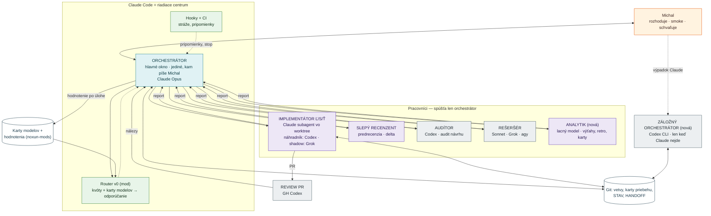
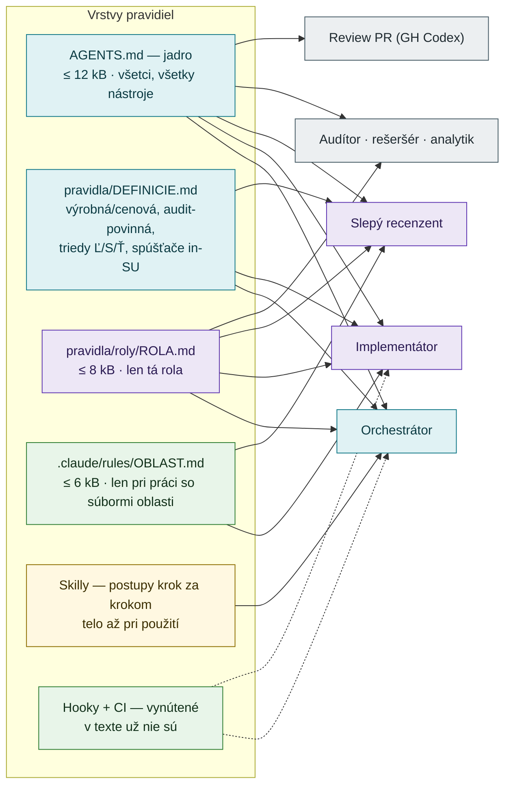
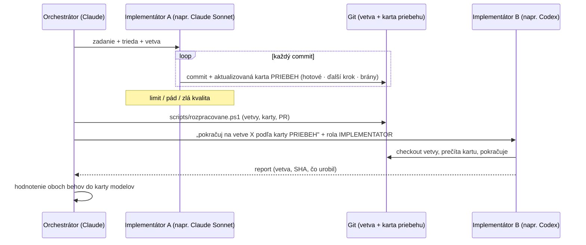

# Blok PRAVIDLA — návrh štruktúry (18.10.2026, orchestrátor)

> **Stav: Michal odpovedal na všetky otázky § 9 (1–5 a 7 dňa 19.10., 6 a rozdelenie P1 dňa 22.10.2026 — rámček „platí" v § 9).**
> 22.10. Michal schválil oddelenie rolí, obsadenia a routera (bod 9); návrh kariet rolí [ROLY.md](ROLY.md) čaká na schválenie. Vstupy: [ZADANIE_BLOKU.md](ZADANIE_BLOKU.md) · [RESERS_POROVNANIE.md](RESERS_POROVNANIE.md) ·
> sonda Claude Code 2.1.299 (§ 1) · prieskum 18 sessions 6.–17.10. lacným modelom ([PRIESKUM_SESSIONS.md](PRIESKUM_SESSIONS.md)) ·
> inventúra pravidiel (§ 3) · koncept routera `noxun-mods/router/NAVRH.md` a benchmark `noxun-mods/benchmark/`.

## 0 · Šesť zásad (čo má nová štruktúra splniť)

| # | Zásada | Ako sa splní |
|---|---|---|
| Z-1 | **Michal píše vždy len do jedného okna — orchestrátora.** Ostatných agentov spúšťa orchestrátor. | Rola orchestrátora je jediná, ktorá hovorí s Michalom; ostatné roly vracajú report orchestrátorovi. |
| Z-2 | **Claude Code je riadiace centrum.** | Hooky, typy agentov, skilly, worktree, PR monitor, mod usage-bar a router žijú v Claude Code; Codex, Grok a Antigravity sú pracovníci volaní cez pluginy. |
| Z-3 | **Rozpracovanú prácu vie prevziať iný provider.** | Stav práce je v gite (vetva + karta priebehu), nie v chate ani v pamäti Claude. Pravidlá sú v AGENTS.md a v súboroch rolí, ktoré číta každý nástroj. |
| Z-4 | **Každá rola dostane len svoje pravidlá.** | Jadro pre všetkých + súbor roly + pravidlá miesta (načítajú sa len pri práci so súbormi danej oblasti). |
| Z-5 | **Čo sa nesmie stať ani raz, stráži stroj, nie text.** | Hooky (rýchla spätná väzba) + CI (posledná brána). Čo je vynútené, z textu zmizne. |
| Z-6 | **Pravidlá nesmú znova „pretiecť".** | Strop veľkosti v CI, história len v archíve, jedna definícia = jeden domov, upratanie pri každom uzávere bloku. |

## 1 · Overené fakty (sonda Claude Code 2.1.299, docs code.claude.com, 18.10.2026)

| Fakt | Dopad na návrh |
|---|---|
| Claude Code číta AGENTS.md (od 2.1.277), ale **keď je v priečinku aj CLAUDE.md, číta len CLAUDE.md**. Odporúčané: CLAUDE.md s riadkom `@AGENTS.md` (symlink na Windows nie). | CLAUDE.md ostane ako tenký most. |
| Import `@súbor` sa rozbalí hneď na štarte — **nešetrí kontext**. | Šetrí len to, čo sa načíta podľa miesta alebo roly. |
| `.claude/rules/*.md` s `paths:` sa načíta, **až keď agent číta alebo upravuje zodpovedajúci súbor**; platí aj pre subagentov s vypnutým CLAUDE.md. | Pravidlá UI, materiálov, kovania… sa presunú sem — ostatné roly ich neplatia. |
| Typ subagenta má pole **`omitClaudeMd: true`** (od 2.1.271) — subagent štartuje bez CLAUDE.md; pole `skills:` vie skill prednačítať. | Implementátor a recenzent nedostanú pravidlá orchestrátora (merge, kvóty, bloky). |
| Hook po nástroji vie vložiť do kontextu poznámku (`additionalContext`); text musí byť **vecné konštatovanie, nie rozkaz** (inak ho Claude môže brať ako injection). Filter na príkaz cez pole `if`, napr. `Bash(gh pr merge *)` (❓ overí sa pri implementácii). | Pripomienka po mergi (retro, hodnotenie, inštalácia) je technicky možná. |
| `/doctor prompt-audit` (od 2.1.283) hľadá spory a zastarané vety v CLAUDE.md, AGENTS.md, pravidlách, skilloch a typoch agentov. | Súčasť uzáveru každého bloku. |
| Codex oreže reťaz AGENTS.md na **32 KiB**; dnešný CLAUDE.md má 35 kB. | Jadro musí byť hlboko pod stropom (cieľ ≤ 12 kB). |

## 2 · Mapa: roly, orchestrácia, pravidlá

### 2.1 Kto s kým hovorí



### 2.2 Kto dostane ktoré pravidlá (vrstvy)



**Ako sa to načíta v praxi:**

| Kto | Čo dostane automaticky | Čo mu dá orchestrátor v zadaní | Odhad kontextu pravidiel |
|---|---|---|---|
| orchestrátor (Claude, hlavné okno) | `CLAUDE.md` = `@AGENTS.md` + `@SYSTEM/pravidla/roly/ORCHESTRATOR.md` | — | ~22 kB (dnes 35 kB) |
| implementátor (Claude typ) | `omitClaudeMd` · telo typu = jadro + `IMPLEMENTATOR.md` + `DEFINICIE.md` (generované skriptom) · pravidlá oblasti podľa súborov | zadanie dávky | ~20 kB + oblasť |
| implementátor (Codex / Grok) | AGENTS.md (nástroj si ho číta sám) | „prečítaj `SYSTEM/pravidla/roly/IMPLEMENTATOR.md`, `DEFINICIE.md` a pravidlá oblasti X" | rovnaké |
| slepý recenzent | `omitClaudeMd` · jadro + `RECENZENT.md` + `DEFINICIE.md` | zadanie + rozsah diffu | ~18 kB |
| audítor (Codex) | AGENTS.md | `AUDITOR.md` + package | ~16 kB |
| review PR (GH Codex) | AGENTS.md, sekcia `## Code Review Rules` (krátka, ❓ overiť, že ju GH Codex číta) | — | v jadre |
| analytik, rešeršér | `omitClaudeMd` · jadro + svoja rola | otázky | ~14 kB |

**Prečo súbory rolí v `SYSTEM/pravidla/roly/` a nie len v `.claude/agents/`:** Codex a Grok čítajú bežné súbory, nie definície Claude typov.
Zdroj pravdy je súbor roly; telo typu v `.claude/agents/` z neho **generuje skript** a guard test stráži, že sú zhodné (Z-3).

### 2.3 Odovzdávanie práce medzi providermi



- **Karta priebehu** `SYSTEM/zdroje/bloky/<BLOK>/priebeh/<DAVKA>.md` — vytvorí ju implementátor pri prvom commite a aktualizuje pri
  každom ďalšom: zadanie (odkaz) · trieda · vetva a základný SHA · hotové kroky (checklist dávky) · **ďalší krok jednou vetou** · otvorené
  otázky · stav brán (audit, testy, in-SU, predrecenzia, PR, review) · kto robil (provider, model). Šablóna v repe, ~25 riadkov.
- **Handoff orchestrátora** sa presúva z pamäte Claude (iný provider ju nevidí) do repa: `SYSTEM/zdroje/bloky/<BLOK>/HANDOFF.md`
  (pushnutý na vetve bloku, bez PR). Pamäť Claude drží len odkaz.
- **`scripts/rozpracovane.ps1`** (nový, súčasť `start_okna.ps1`): otvorené PR, vetvy pred mainom s kartou priebehu, posledný commit,
  ďalší krok. Prvý príkaz každého orchestrátora — aj záložného.
- **Záložný orchestrátor** (Codex CLI interaktívne, ❓ potvrdí Michal): Michal ho otvorí len pri výpadku alebo limite Claude. Číta AGENTS.md +
  `ORCHESTRATOR.md` + HANDOFF. Smie pokračovať v rozpracovaných dávkach Ľ/S a docs a mergovať ich po bránach; **dávky Ť, výrobné/cenové
  a uzáver bloku nemerguje** — čakajú na Claude. Pri návrate Claude prečíta HANDOFF a pokračuje.

### 2.4 Po každej úlohe: hodnotenie + retro (jeden záznam)

```mermaid
flowchart LR
  T["Delegovaná úloha skončila<br/>alebo PR zmergovaný"]:::auto
  HK["Hook po gh pr merge:<br/>„hodnotenie pre PR #N chýba"<br/>(vecná poznámka, nie rozkaz)"]:::auto
  Z["scripts/hodnotenie.ps1<br/>1 riadok JSONL: model · rola · trieda ·<br/>výsledok · skóre 1–5 · kolá · pasca · postreh"]:::orch
  J[("noxun-mods/hodnotenia/<br/>hodnotenia.jsonl")]:::store
  KA["Karty modelov<br/>(generuje skript)"]:::store
  RT["Uzáver bloku: analytik vyhodnotí<br/>postrehy → najviac 3 návrhy"]:::sub
  M["Michal rozhodne"]:::michal
  RO["Router v0"]:::auto
  T --> HK --> Z --> J
  J --> KA --> RO
  J --> RT --> M
  classDef michal fill:#fff3e0,stroke:#e65100,color:#3e2723
  classDef orch fill:#e0f2f4,stroke:#107787,color:#0b3a42
  classDef sub fill:#ede7f6,stroke:#5e35b1,color:#2a1a52
  classDef auto fill:#e8f5e9,stroke:#2e7d32,color:#12301a
  classDef store fill:#ffffff,stroke:#1b3a4b,color:#1b3a4b
```

- **Retro a hodnotenie modelu sa zlučujú do jedného zápisu** — orchestrátor po každej delegovanej úlohe zapíše riadok (aj „ok, bez postrehov").
  Jeden príkaz, žiadny súbor v inboxe, žiadna voľba „ticho". Hook po mergi pripomenie, keď záznam pre PR chýba.
- **Kam:** `noxun-mods/hodnotenia/hodnotenia.jsonl` — spoločné pre všetky projekty (karty modelov), absolútna cesta, takže worktree nevadí
  (dnes inbox v hlavnom checkoute → zápisy z worktree sa strácali). ❓ potvrdí Michal (otvorená otázka zadania).
- **Karta modelu** (generuje skript, ≤ 15 riadkov na model): na čo sa osvedčil · na čo nie · pasce (posledných 5) · skóre **slepé**
  (benchmark) a **rýchle** (orchestrátor) zvlášť s počtom behov · priemerný čas a spotreba. `karty/PREHLAD.md` (jedna tabuľka) vypíše
  `start_okna.ps1` — orchestrátor tak vie, koho spúšťa.
- **Stupnica 1–5** (benchmark ju už má; Michalovo „7/10" ≈ 3,5). Router berie slepé skóre, keď má ≥ 3 behy, inak rýchle. ❓ potvrdí Michal.
- **Vyhodnotenie** sa viaže na **uzáver bloku**, nie na dátum: analytik (lacný model) prečíta záznamy bloku → najviac 3 návrhy s dôkazmi → Michal.

## 3 · Inventúra pravidiel (CLAUDE.md 35 kB → cieľové miesto)

Počty výskytov tej istej témy v CLAUDE.md · WORKFLOW.md · typoch agentov · skilloch (grep 18.10.): predrecenzia **59×** v 8 súboroch,
výrobná/cenová 13× v 3, Codex weekly prah 14× v 5, `-CloseWhenDone` 7× v 6, ENGINEtests 8× v 6, pravidlo 3 kôl 5× v 3.
**To je hlavný zdroj zmätku: tá istá veta v 3–8 verziách, každá trochu iná.**

| Pravidlo (sekcia CLAUDE.md) | Potrebuje rola | Dá sa vynútiť strojom? | Cieľové miesto |
|---|---|---|---|
| Povinné čítanie podľa typu práce (6,4 kB) | implementátor, recenzent, audítor | čiastočne (načítanie podľa cesty) | **`.claude/rules/<oblasť>.md`** s `paths:` (UI, konštrukcia, materiály, kovanie, výstupy, testy, DC); v jadre len 10-riadkový rozcestník |
| Roly a modely, triedy Ľ/S/Ť | orchestrátor; implementátor (reklasifikácia) | nie | triedy → `DEFINICIE.md`; obsadenie len WORKFLOW § 2 (už je) |
| Žiadne commity do `main`, vetvy, PR | všetci | **áno** — hook PreToolUse + ochrana vetvy na GitHube | jadro (1 veta) + hook + ❓ branch protection |
| Merge s `--match-head-commit`, po bránach | orchestrátor | **áno** — hook odmietne merge bez pripnutej hlavy | `ORCHESTRATOR.md` + skill `codex-po-pr` |
| Review kolá, delta, pravidlo 3 kôl, opravy z review | orchestrátor | nie | **len skill `codex-po-pr`**; v ORCHESTRATOR 2 vety s odkazom |
| Definícia výrobnej/cenovej dávky, nový prvok UI | orchestrátor, implementátor, recenzent | nie | **len `DEFINICIE.md`** |
| Audit návrhu, sonda pred auditom | orchestrátor | nie | skill `codex-audit`; v ORCHESTRATOR odkaz |
| Predrecenzia — kedy povinná | orchestrátor, implementátor (stop pred PR) | čiastočne (CI vie zmerať diff a overiť sekciu „Predrecenzia" v PR) | kedy → `DEFINICIE.md`; postup → skill |
| Rešerš, krížový audit, štart bloku, mockup | orchestrátor | nie | `ORCHESTRATOR.md` (tok bloku) |
| Bezpečnosť externých nástrojov (agy nie v noci, žiadne proxy) | orchestrátor | čiastočne | `ORCHESTRATOR.md` + typ `agy-reserser` |
| PR popis po slovensky, commit trailer | implementátor | trailer áno (hook commit-msg / CI) | jadro (2 vety) |
| Kvóty a štart okna | orchestrátor | **áno** — `start_okna.ps1`, usage-bar, router | `ORCHESTRATOR.md` (prahy v 1 tabuľke) + skill `usage` |
| Autonómne bloky, tabuľka „keď Michal neodpovie" | orchestrátor | nie | `ORCHESTRATOR.md` |
| Report, retro | orchestrátor | retro áno (hook) | `ORCHESTRATOR.md` + hook + `hodnotenie.ps1` |
| Verzia 2×, `?v=`, checklist uzáveru dávky | implementátor | **áno** — guard testy už sú (verzia, `?v=`) | `IMPLEMENTATOR.md` (checklist) — vety o tom, čo stráži guard, zmiznú |
| Číslo PR `PR #?` | implementátor, orchestrátor | **áno** — CI odmietne `PR #?` v hlave pred mergom | `IMPLEMENTATOR.md` + guard |
| Uzáver bloku (release, archív, presuny) | orchestrátor | nie | skill `uzaver-bloku` (nový, telo z CLAUDE.md) |
| Špecifikácia a kontext (odkazy) | všetci | — | jadro (rozcestník) |
| Headless + JS testy, príkazy | implementátor, recenzent | **áno** | jadro (1 príkaz `scripts\run_js_tests.ps1`) |
| In-SU runner, `-CloseWhenDone`, zámok, finálna hlava | implementátor | **áno** — hook odmietne runner bez `-CloseWhenDone` | `.claude/rules/testy.md` + `DEFINICIE.md` (spúšťače) |
| Fotenie okien, export test | implementátor (UI, výstupy) | — | `.claude/rules/ui.md`, `.claude/rules/vystupy.md` |
| Lokálne hooky, ukazovateľ kontextu (popis) | nikto pri práci | — | `docs/` (popis hookov); v ORCHESTRATOR len prahy 75/90 % |
| Testovať len v ENGINEtests, nikdy v zákazke | všetci | čiastočne (runner) | **jadro** (zákaz) |
| História („od 12.8.", „revízia 27.9.", PR #398…) | nikto | **áno** — CI guard na dátumy v pravidlách | archív / KRONIKA, v pravidle len platné znenie |

## 4 · Roly — katalóg v2

| Rola | Kto (dnes) | Dostáva | Smie | Nesmie | Vracia |
|---|---|---|---|---|---|
| **orchestrátor** | Claude Opus, hlavné okno | jadro + ORCHESTRATOR + skilly | plánovať, delegovať, triediť nálezy, mergovať po bránach, inštalovať main | písať kód pluginu (deleguje); mergovať bez brán | Michalovi: report, otázky |
| **záložný orchestrátor** *(nová, ❓)* | Codex CLI `gpt-6.1-sol` interaktívne | jadro + ORCHESTRATOR + HANDOFF | pokračovať v Ľ/S a docs dávkach, merge po bránach | merge Ť, výrobných/cenových, uzáver bloku | HANDOFF na návrat Claude |
| **implementátor Ľ/S/Ť** | Claude Sonnet/Opus subagent; náhradník Codex; shadow Grok | jadro + IMPLEMENTATOR + DEFINICIE + oblasť | kód, testy, docs, commity, push, PR | merge, spúšťať ďalších agentov | vetva, SHA, karta priebehu, report |
| **slepý recenzent** | Claude Opus · pri Ť navyše Codex sol (iný provider než implementátor, ❓) · ❓ Sonnet pre delta P2/P3 v Ľ/S | jadro + RECENZENT + DEFINICIE | len čítať (bez `git fetch`) | meniť čokoľvek | nálezy P1–P3 + VERDIKT |
| **audítor** | Codex `gpt-6.1-sol` predvolene · `gpt-6-astra` len úzko | jadro + AUDITOR + package | len čítať | široké zadania (Astra zjedla 5 h okno) | BLOCKER / FIX / NOTE |
| **rešeršér** | Sonnet (web), Grok, agy | jadro + RESERSER | web, čítať | agy v behoch bez obsluhy | zistenia so zdrojmi |
| **analytik** *(nová)* | lacný model (Sonnet medium, ❓ Haiku na výťahy) | jadro + ANALYTIK | čítať repo, záznamy sessions, hodnotenia | meniť repo | správa s dôkazmi |
| **review PR** | GH Codex | AGENTS.md § Code Review Rules | — | — | nálezy v threadoch |
| **automaty** | CI, runner, hooky, router, usage-bar | — | blokovať, pripomínať, odporúčať | rozhodovať | stav brán |

**Prečo analytik:** dnes sa široké čítanie (prieskum sessions, výťahy z veľkých súborov, vyhodnotenie retro, inventúry) robí cez
všeobecný typ, ktorý **dedí celý CLAUDE.md vrátane pravidiel orchestrátora** a beží na drahom modeli. Vlastný typ s `omitClaudeMd`
a lacným modelom je lacnejší a nemá pokušenie robiť prácu orchestrátora. Prieskum tejto session ukázal postup: skript zhustí záznamy
(~100 MB → 317 kB), analytik ich prejde (`scripts/session_digest.py` sa pridá do repa).

## 5 · Stráže (čo stráži stroj)

| # | Stráž | Typ | Čo zachytí |
|---|---|---|---|
| G1 | strop veľkosti: AGENTS.md ≤ 12 kB a ≤ 150 riadkov · CLAUDE.md ≤ 1 kB · rola ≤ 8 kB · oblasť ≤ 6 kB · skill ≤ 500 riadkov | CI test | opätovné „pretekanie" |
| G2 | žiadna história v pravidlách (vzory „od 12.8.2026", „revízia", „PR #398" v `AGENTS.md`, `pravidla/`, `.claude/rules/`) | CI test | dopisovanie s dátumom namiesto prepisu |
| G3 | jedna definícia: kľúčové definície (výrobná/cenová, audit-povinná, triedy, spúšťače in-SU) len v `DEFINICIE.md` | CI test | rozchádzajúce sa verzie tej istej vety |
| G4 | typy agentov = generované zo súborov rolí, všetky s `omitClaudeMd: true` | CI test (rozšírenie `test_agent_definitions.rb`) | rola s cudzími pravidlami, rozsynchronizovanie |
| G5 | commit/push na `main`, `gh pr merge` bez `--match-head-commit`, runner bez `-CloseWhenDone` | hook PreToolUse (odmietne) | „nesmie sa stať ani raz" |
| G6 | po `gh pr merge`: poznámka „inštalácia mainu a hodnotenie pre PR #N zatiaľ chýbajú" | hook PostToolUse | zabudnuté retro, inštalácia |
| G7 | `PR #?` v hlave vetvy pri merge | CI test | zabudnuté číslo PR |
| G8 | ochrana vetvy `main` na GitHube (len cez PR, CI povinné) | nastavenie GitHubu — **urobí Michal** (❓) | posledná poistka, keby hook zlyhal |
| G9 | `/doctor prompt-audit` + upratanie pri uzávere bloku | krok uzáveru | spory a mŕtve vety |
| G10 | implementátor hlási „hotovo" až so zeleným CI pushnutej vetvy (`gh run watch`) | krok v IMPLEMENTATOR + kontrola orchestrátora | chyba na Linuxe zistená až v PR (#467) |
| G11 | jeden beh Codexu nad 30 % okna → upozornenie | router / usage-bar | široké zadanie zje okno (Astra 16.10.) |

Zásada: hook je rýchla spätná väzba, **CI je posledná brána** (hooky Groka sú fail-open; hook môže spadnúť).

## 6 · Ekonomika

- **Kontext:** orchestrátor ~22 kB pravidiel namiesto 35 kB; implementátor a recenzent ~18–20 kB **bez** pravidiel orchestrátora
  (dnes 35 kB + definícia typu). Codex konečne vidí pravidlá celé (dnes mu spodok CLAUDE.md odpadá pri 32 KiB).
- **Lacný model tam, kde stačí:** analytik (výťahy, retro, karty) · ❓ delta-kontrola opráv P2/P3 v dávkach Ľ/S Sonnetom namiesto Opusu ·
  predrecenzia Ť ostáva Opus. Podklad: prieskum sessions (§ 7).
- **Úzke zadania pre Codex** — jedna otázka, presné súbory (pasca Astra 17.10.: široké zadanie zjedlo 5 h okno bez výsledku).
- **Router** odporučí podľa kvót a kariet „počkaj X min" alebo náhradníka — orchestrátor nemusí ručne prepočítavať prahy.

## 7 · Prieskum sessions 6.–17.10.2026

Surový výstup analytika (Sonnet, 18 sessions + 7 retro záznamov): [PRIESKUM_SESSIONS.md](PRIESKUM_SESSIONS.md). Čo z neho návrh preberá:

| Zistenie (dôkaz v prieskume) | Zmena v návrhu |
|---|---|
| Tá istá veta na 3–8 miestach → review opakovane nachádza zabudnuté kópie (#464, #465 2×P1, #468 6×P2) | jadro + DEFINICIE + guard G3 (jedna definícia) — **hlavný dôvod bloku potvrdený dátami** |
| Retro: 0 záznamov za 15 dní a ~14 PR | retro + hodnotenie = jeden povinný riadok, hook G6 (§ 2.4) |
| Slepý recenzent Opus na kóde od Opusu nenašiel 3 P2, Codex sol áno; úzky Codex sol mal najlepší pomer cena / nález | **predrecenzia dávky Ť iným providerom než implementátor** (Codex sol + Opus, keď kvóta dovolí) — ❓ 4 |
| Astra so širokým zadaním zjedla celé 5 h okno bez výsledku | AUDITOR: zadanie = konkrétne súbory a otázky; predvolene sol, Astra len úzko; router upozorní nad 30 % okna na jeden beh (G11) |
| Linux CI spadlo až po otvorení PR (#467), GH 👍 to nezachytí | IMPLEMENTATOR: pred reportom „hotovo" počkať na zelené CI pushnutej vetvy (G10) |
| Oprava jednej vety / komentára = 16–24 min celého rituálu, 0 nálezov (#469, #474) | trieda **D drobnosť** — ❓ 7 |
| Číslo PR ako ručný commit v 9 z 11 PR, raz zablokované filtrom | skript `doplň_cislo_pr.ps1` (P4) — ❓ 7 |
| KRONIKA navrchu = konflikt pri dvoch PR naraz (#468 vs #469) | záznam dávky ako samostatný súbor, zlúčenie pri uzávere bloku — ❓ 7 |
| Inštalácia mainu po docs PR sa robila 1 zo 4 (zbytočná) | inštalovať len po PR, ktorý mení plugin; hook G6 to rozlíši — ❓ 7 |
| Hlavné okno 2× začalo samo implementovať | prvá veta ORCHESTRATOR.md: „hlavné okno je orchestrátor, kód pluginu deleguje" |
| Haiku (`claude-code-guide`) dal nesprávny fakt, ktorý skončil vo WORKFLOW | ORCHESTRATOR: fakt o nástroji ide do pravidiel až po sonde na lokálnej verzii |
| Nová session dostala len slovo „UPDATE"; smoke zápisník bol v nepushnutej vetve | HANDOFF.md a karta priebehu vždy pushnuté; zadanie novej session = cesta k dokumentu + vetva |
| Budíky `sleep` a cron sa pri výpadku stratili | skill `codex-po-pr`: čakanie cez Monitor / plánovač (P4) |
| Smoke 94 bodov, časť bez hodnoty pre Michala | skill `smoke`: Michal najprv škrtne nerelevantné, overiteľné body robí agent cez bridge (P3) |
| Kontrola vetvy, ktorá sa nakoniec nezmergovala (H11c) | karta priebehu nesie stav „aktívna / odložená"; `rozpracovane.ps1` ho ukáže |
| `_dev` 3,7 GB, worktrees ~1 GB, chyby „cesta príliš dlhá" | skill `uzaver-bloku`: upratanie `_dev` a worktree |

**Čo funguje a nemeniť:** brief a package v repe od štartu bloku · pokračovanie toho istého implementátora po limite (SendMessage) ·
profily Ľ/S na Sonnete (#470, #473 čisté v kole 1) · uzáver bloku čerstvým subagentom · rovnaké zadanie rešerše pre dvoch providerov ·
tenké obaly na Sonnete/Haiku pre Codex, Grok a agy.

## 8 · Dávky bloku (návrh poradia)

| Dávka | Obsah | Trieda / profil | Hotovo, keď |
|---|---|---|---|
| **P0** | tento návrh + diagramy + inventúra + prieskum | orchestrátor | Michal schváli a odpovie na ❓ |
| **P1 Jadro** | `AGENTS.md` (jadro + Code Review Rules) · `CLAUDE.md` most · `pravidla/DEFINICIE.md` · `ORCHESTRATOR.md` · guardy G1–G3 | Ť (`implementator`, presná mapa z § 3) | CLAUDE.md ≤ 1 kB, AGENTS.md ≤ 12 kB, testy zelené, žiadne pravidlo nestratené (kontrolný zoznam z § 3 odškrtaný slepým recenzentom) |
| **P2 Roly** | súbory rolí · generátor typov · `omitClaudeMd` · typ `analytik` · guard G4 | S | každý typ dostane len svoje pravidlá (`/context` v subagentovi) |
| **P3 Oblasti a postupy** | `.claude/rules/*.md` s `paths:` · WORKFLOW.md ostane mapou bez kópií pravidiel · skilly `uzaver-bloku` (vrátane upratania `_dev`) a `smoke` | S | povinné čítanie sa načíta samo pri práci s danými súbormi |
| **P4 Stroje** | hooky G5–G6 · guardy G7, G10 · `run_js_tests.ps1` · runner berie ENGINEtests z hlavného checkoutu · `rozpracovane.ps1` · šablóna karty priebehu · `session_digest.py` · podľa ❓ 7 skript čísla PR a KRONIKA po súboroch · čakanie v `codex-po-pr` cez Monitor | S | hook test aj na povolený prípad (nie len zakázaný) |
| **P5 Hodnotenia** | `hodnotenie.ps1` · karty modelov + PREHLAD · napojenie routera v0 · vyhodnotenie retro inboxu 27.9.–2.10. | S (noxun-mods + ENGINE) | po mergi sa hodnotenie pripomenie a zapíše; PREHLAD v `start_okna` |
| **P6 Uzáver** | `/doctor prompt-audit` · **smoke pravidiel** (nižšie) · archív | orchestrátor | smoke PASS |

**Smoke pravidiel (akceptačný test bloku):**
1. Sonnet implementátor dostane jadro + svoju rolu, nie pravidlá merge (`/context` v subagentovi).
2. Codex prečíta AGENTS.md celé (otázka na poslednú vetu súboru).
3. **Prevzatie práce:** Claude implementátor sa zastaví v polovici dávky → Codex pokračuje len z vetvy a karty priebehu → dávka prejde bránami.
4. Po mergi príde pripomienka hodnotenia; záznam sa objaví v karte modelu.
5. Pokus o commit do `main` a merge bez pripnutej hlavy hook odmietne.
6. Záložný orchestrátor (Codex) prečíta HANDOFF a správne povie, čo je rozpracované a čo nesmie mergovať.

## 9 · Otvorené otázky pre Michala (❓)

> **Platí — odpovede Michala 19.10.2026** (majú prednosť pred textom vyššie):
> 1. **Záložný orchestrátor Codex — áno.** Pri výpadku alebo limite Claude Michal prejde do Codexu. Obmedzenia z § 2.3 platia ako predvolené;
>    Michal ich smie v konkrétnom prípade výslovne zrušiť („musím byť flexibilný").
> 2. **Karty modelov a hodnotenia v `noxun-mods` — áno.**
> 3. **Stupnica 1–5 bez prepočtu na x/10.**
> 4. **Recenzia podľa rizika — áno** (a: Ť navyše Codex sol · b: kontrola opráv P2/P3 v Ľ/S Sonnetom).
> 5. **Ochranu vetvy `main` na GitHube zapne Michal.**
> 6. **(22.10.) Retro a hodnotenie modelu zlúčiť do jedného povinného záznamu po každej delegovanej úlohe — áno, s dvomi úpravami:**
>    (a) povolený aj záznam bez modelu (rola „workflow") pre postrehy o procese, Michalovu spätnú väzbu a problémy celého bloku;
>    (b) pri skóre 1–2 alebo 4 a viac kolách review je pole „postreh" povinné (proti rutinnému „ok, 4").
> 7. **Zjednodušenia a–e — áno všetky** (trieda D drobnosť · inštalácia len po zmene pluginu · číslo PR skriptom · KRONIKA po súboroch ·
>    experimenty s ľahkou bránou).
> 8. **(22.10.) P1 sa delí:** **P1a** = `DEFINICIE.md` + guard G3 (kópie definícií v CLAUDE.md, WORKFLOW a skilloch nahradí odkaz) ·
>    **P1b** = `AGENTS.md` jadro + most `CLAUDE.md` + `ORCHESTRATOR.md` + guardy G1–G2. Drobnosti z P4 (JS testy jedným príkazom,
>    runner berie ENGINEtests z hlavného checkoutu, skript čísla PR, pripomienka po mergi) idú hneď za P1a.
> 9. **(22.10.) Roly a router:** oddeliť **rolu** (čo robí a čo dostane) · **obsadenie** (ktorý model) · **router** (koho teraz) ·
>    7 rolí (orchestrátor, implementátor, recenzent, audítor, rešeršér, analytik, review PR) · záložný orchestrátor je režim, nie rola ·
>    router v0 pevný (pravidlá + kvóty), učiaci v1 až s dátami. Karty rolí, typy úloh a návrh obsadenia: [ROLY.md](ROLY.md) — schvaľuje Michal pred úvodným PR bloku.

1. **Záložný orchestrátor Codex** — zaviesť (a s obmedzeniami z § 2.3), alebo pri výpadku Claude len čakať?
2. **Karty modelov a hodnotenia v `noxun-mods`** (spoločné pre všetky projekty) — áno?
3. **Stupnica 1–5** (s prepočtom „≈ x/10" v karte) — áno?
4. **Recenzia podľa rizika:** (a) predrecenzia dávky Ť navyše Codexom sol (iný provider než implementátor, dôkaz: šírka 50) a (b) kontrola
   opráv P2/P3 v dávkach Ľ/S Sonnetom namiesto Opusu (úspora) — oboje áno?
5. **Ochrana vetvy `main` na GitHube** (G8) — zapneš ju v nastaveniach repa (urobíš sám, ja nemením nastavenia účtu)?
6. **Retro zlúčiť s hodnotením modelu** do jedného povinného riadku (inbox zanikne) — áno?
7. **Zjednodušenia rituálu** (každé zvlášť áno/nie): (a) trieda **D drobnosť** — oprava komentára alebo vety bez zmeny správania: Sonnet,
   bez prepisu STAV, review len kolo 1 · (b) **inštalácia mainu len po PR, ktorý mení plugin** · (c) **číslo PR doplní skript** · (d) **KRONIKA
   po súboroch** (záznam dávky = samostatný súbor, zlúčenie pri uzávere bloku, žiadne konflikty) · (e) **experimenty a benchmarky** s ľahkou
   bránou (CI + jeden slepý pohľad).
